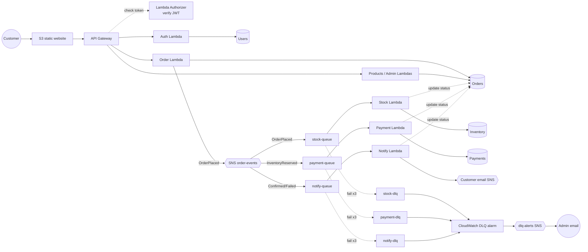
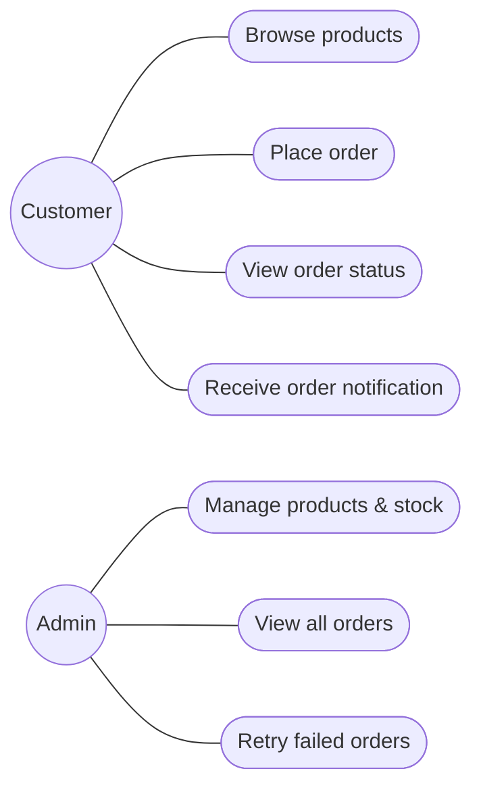

# AWS Serverless Order Management System

An event-driven e-commerce order system for the **AWS Academy Cloud Developing** course. Customers browse
products, place orders and watch each order move through independent services — stock, payment and
notification — connected by SNS and SQS. A failure in one service never loses an order: messages retry,
land in dead-letter queues, raise CloudWatch alarms, and administrators can retry the order from the UI.

Everything is deployed with **Terraform**: React frontend on S3, API Gateway with a Lambda Authorizer (JWT),
8 Python Lambda functions, 7 DynamoDB tables, SNS, 3 SQS queues + 3 DLQs, and CloudWatch alarms.

> **Status of verification** – see [Test results](#17-testing). Backend logic, local end-to-end flows and
> the UI were executed and tested. `terraform validate/plan` and a real AWS deployment have **not** been run
> by the author's build environment (no Terraform binary or AWS access there) — do that as the first step.

---

## Contents
1. [Overview](#1-overview) · 2. [Architecture](#2-architecture) · 3. [Architecture diagram](#3-architecture-diagram) ·
4. [Use cases](#4-use-cases) · 5. [Technology](#5-technology-stack) · 6. [Prerequisites](#6-prerequisites) ·
7. [AWS Academy credentials](#7-aws-academy-credentials) · 8. [Local development](#8-local-development) ·
9. [Terraform deployment](#9-terraform-deployment) · 10. [Frontend deployment](#10-frontend-build-and-deployment) ·
11. [API](#11-api) · 12. [Database](#12-database-schema-and-access-patterns) · 13. [State machine](#13-order-state-machine) ·
14. [SQS retry & DLQ](#14-sqs-retry-and-dlq-behaviour) · 15. [Monitoring](#15-cloudwatch-monitoring) ·
16. [Security](#16-security-design) · 17. [Testing](#17-testing) · 18. [Troubleshooting](#18-troubleshooting) ·
19. [Cost](#19-cost-considerations) · 20. [Cleanup](#20-cleanup) · 21. [Known limitations](#21-known-limitations)

## 1. Overview

| Role | Can do |
|---|---|
| Customer | browse products and stock · cart · place an order · track its progress live · order history · notifications |
| Admin | dashboard · all orders with filters · order detail · create/edit products · adjust stock · retry or cancel failed/stuck orders · view queues, DLQs and alarms · redrive a DLQ |

Placing an order returns **202 Accepted** with status `PENDING` immediately; stock, payment and
notification happen asynchronously and the order page polls for the result.

## 2. Architecture

1. **Order Lambda** validates the request, prices it from the Products table (client prices are rejected),
   and in one DynamoDB transaction stores the idempotency record and the `PENDING` order with an *outbox
   marker*. It then publishes `OrderPlaced` to SNS and clears the marker. If publishing fails, a scheduled
   outbox publisher republishes it — an order can never be stored without its event.
2. The **order-events** SNS topic fans out to three SQS queues using **filter policies** on `eventType`:
   stock ← `OrderPlaced`, payment ← `InventoryReserved`, notify ← `OrderConfirmed`/`OrderFailed`.
3. **Stock Lambda** reserves every line in one transaction (`available >= qty` conditions) and moves the order to
   `PROCESSING`, or marks it `FAILED / OUT_OF_STOCK`. All-or-nothing; stock is never negative.
4. **Payment Lambda** (simulated) records the payment and, in the same transaction, either confirms the order and
   commits the stock or fails it and **releases the reservation** (compensation).
5. **Notify Lambda** records a deduplicated in-app notification and optionally emails through SNS.
6. Each queue retries 3 times, then moves the message to its **DLQ** → CloudWatch alarm → **dlq-alerts** SNS → admin email.

Details: [docs/architecture.md](docs/architecture.md) · [docs/order-workflow.md](docs/order-workflow.md)

## 3. Architecture diagram



## 4. Use cases



## 5. Technology stack

| Layer | Technology |
|---|---|
| Frontend | React 19, TypeScript, Vite, React Router, plain CSS (responsive) |
| API | Amazon API Gateway HTTP API, Lambda Authorizer (HS256 JWT) |
| Compute | AWS Lambda, Python 3.12, boto3 (no other runtime dependencies) |
| Data | Amazon DynamoDB (on-demand, transactions, GSIs, TTL, PITR) |
| Messaging | Amazon SNS (filter policies, raw delivery), Amazon SQS + DLQs, EventBridge schedule |
| Identity | Auth Lambda + Users table (PBKDF2 password hashes, role per user), JWTs signed with a Terraform-generated key |
| Monitoring | CloudWatch Logs (JSON), Metrics, Alarms → SNS |
| IaC | Terraform ≥ 1.6, AWS provider ~> 5.70 |
| Tests | pytest (+ moto optional), Vitest, end-to-end script |

## 6. Prerequisites
Terraform ≥ 1.6, AWS CLI v2, Python ≥ 3.12, Node.js ≥ 20, an AWS Academy Learner Lab (or any AWS account).

## 7. AWS Academy credentials
Start the lab → **AWS Details › AWS CLI** → paste into `~/.aws/credentials` → `aws configure set region us-east-1`
→ verify with `aws sts get-caller-identity` and `scripts/check-aws.sh`. Credentials expire with the session; never
put them in this repository. Full steps: [docs/deployment.md](docs/deployment.md#2-aws-academy-credentials).

## 8. Local development

No AWS account or third-party Python packages are needed. The dev server runs the **real Lambda handlers**
against in-memory DynamoDB/SNS/SQS stand-ins and delivers queue messages to the workers.

```bash
cd backend
pip install -r requirements-dev.txt            # pytest, ruff, mypy (+ optional moto, boto3)
pytest                                         # unit + workflow + security tests
python3 local/dev_server.py                    # http://127.0.0.1:8000 (simulated AWS)

cd ../frontend
cp .env.example .env.local && npm install && npm run dev   # http://localhost:5173
```
Local accounts: `customer@example.com / Customer123!`, `other@example.com / Customer123!`,
`admin@example.com / Admin123!`. Seeded products include deterministic test scenarios:

| Scenario | How |
|---|---|
| Successful order | any normal product |
| Out-of-stock order | order 2 × *Limited Edition Mug* (stock 1), or two customers order it at once |
| Payment failure | *TEST - Declined Payment Item* |
| Temporary failure → DLQ → recovery | *TEST - Flaky Payment Item* (fails on attempt 0, retry succeeds; locally "stuck" after 20 s) |
| Duplicate event | `tests/test_workflow.py::test_duplicate_*` |

| Feature | Local | Needs AWS |
|---|---|---|
| All API routes, validation, auth roles, workflow, retries, DLQ, outbox | ✅ simulated | – |
| Lambda Authorizer behind API Gateway, CORS, throttling | real authorizer code, gateway simulated by the dev server | ✅ |
| Real SNS/SQS delivery, visibility timeouts, CloudWatch alarms, emails | simulated | ✅ |
| boto3 serialisation layer | via `tests/test_boto_gateway_moto.py` (moto) | ✅ |

Local results are simulations and do not prove the AWS deployment works.

## 9. Terraform deployment

```bash
cp terraform/terraform.tfvars.example terraform/terraform.tfvars   # set admin_alert_email
scripts/deploy.sh                                                   # checks, init, validate, plan, apply, seed, frontend
scripts/create-admin.sh admin@example.com 'ChangeMe123'
```
Key variables: `use_lab_role` (true in Academy), `enable_cloudfront`, `enable_customer_email`,
`admin_alert_email`, `payment_simulation_mode`, `enable_test_scenarios`, `cors_allowed_origins`.
Outputs: `api_url`, `frontend_url`, `table_names`, `queue_urls`, … ([docs/deployment.md](docs/deployment.md)).

## 10. Frontend build and deployment
`scripts/deploy-frontend.sh` writes `frontend/.env.production.local` (`VITE_API_BASE_URL` from Terraform),
runs `npm ci && npm run build`, and syncs `dist/` to the bucket (`index.html` uncached, assets immutable).
See [frontend/README.md](frontend/README.md).

## 11. API
22 routes — public catalogue, auth, customer orders/notifications, admin. OpenAPI: [backend/openapi.yaml](backend/openapi.yaml);
guide with examples: [docs/api.md](docs/api.md).

## 12. Database schema and access patterns
Orders (4 GSIs incl. a sparse outbox index), Products (catalog GSI), Inventory, Payments (`orderId`+`attempt`),
Notifications, Users, Idempotency (TTL). Customer-facing reads never scan. [docs/database-design.md](docs/database-design.md)

## 13. Order state machine

| From | Event | To |
|---|---|---|
| — | order placed | `PENDING` |
| `PENDING` | stock reserved | `PROCESSING` |
| `PENDING` | insufficient stock | `FAILED` (`OUT_OF_STOCK`) |
| `PROCESSING` | payment approved | `CONFIRMED` (stock committed) |
| `PROCESSING` | payment declined | `FAILED` (stock released) |
| `PENDING`/`PROCESSING`/`FAILED` | admin cancel | `CANCELLED` (stock released if reserved) |
| `FAILED` (out of stock, restocked) | admin retry | `PENDING` (new attempt) |

All transitions are conditional writes on the expected source state; duplicates and late events change nothing.
Full table and race-condition analysis: [docs/order-workflow.md](docs/order-workflow.md).

## 14. SQS retry and DLQ behaviour
* Visibility timeout 120 s (6 × worker timeout), `maxReceiveCount = 3`, partial batch failure reporting.
* Transient errors → message returns to the queue; after 3 receives → DLQ.
* Permanent errors (invalid message, unknown order) → copied to the DLQ immediately with `errorReason`, not retried.
* Every consumer is idempotent (conditional writes, deterministic ids, attempt numbers).
* Recovery: Admin › Failed orders → **Retry** (new attempt; old messages become stale) or **Redrive** the DLQ.

## 15. CloudWatch monitoring
Log groups for every function and the API (7-day retention), JSON logs with `correlationId` and `orderId`.
Alarms (all → `dlq-alerts` SNS → `admin_alert_email`): DLQ not empty ×3, oldest message age ×3,
Lambda errors ×8, API 5xx. Thresholds are Terraform variables. See [docs/troubleshooting.md](docs/troubleshooting.md).

## 16. Security design
Lambda Authorizer (JWT) + hashed passwords, server-side role and ownership checks, server-side pricing, idempotency, least-privilege
roles (outside the lab), encryption at rest and in transit, restricted CORS, throttling, redacted logs, no secrets in
code or frontend, no card data. [docs/security.md](docs/security.md)

## 17. Testing

```bash
scripts/validate.sh                    # every offline check available on your machine
cd backend && pytest                   # 83 tests (+ moto and OpenAPI checks when moto/PyYAML are installed)
cd frontend && npm test                # 14 Vitest tests
python3 scripts/e2e_test.py --allow-mutations --admin-email … --admin-password …   # against AWS or local
```

### Test results from the build environment (2026-10-27)

| Check | Result | Notes |
|---|---|---|
| Backend pytest | ✅ **83 passed**, 2 skipped | skipped: moto/boto3 test (packages unavailable offline) and the OpenAPI check (PyYAML missing in the test venv — the same check was run separately and passed) |
| ruff lint + format, mypy (`check_untyped_defs`) | ✅ clean | |
| E2E script vs local dev server | ✅ **22/22**, including DLQ → admin retry | simulated AWS |
| Frontend unit tests (14) | ✅ passed | run under Node with a minimal Vitest shim — run `npm test` for the real runner |
| Frontend bundle + browser smoke test | ✅ built with esbuild, exercised with Playwright (customer checkout, live tracking, admin retry), no runtime errors | React Router replaced by a local shim because npm was unreachable |
| Frontend `tsc` | ⚠️ only checked against approximate stub typings | run `npm run typecheck` |
| Terraform | ⚠️ static reference checker passed; **`terraform fmt/validate/plan` not run** | no Terraform binary available |
| AWS deployment / AWS integration tests | ❌ **not run** | no AWS credentials in the build environment |

Coverage of the required unit-test areas: validation, server-side prices, idempotency, invalid products/quantities,
availability, concurrent reservations, duplicate messages, payment success/failure, compensation, transitions,
retry eligibility, ownership, admin role, notification dedupe — in `backend/tests/`.

## 18. Troubleshooting
Correlation-id log search, Logs Insights queries, common lab errors (expired credentials, LabRole, KMS),
stuck orders and DLQ recovery: [docs/troubleshooting.md](docs/troubleshooting.md).

## 19. Cost considerations
Serverless and on-demand only — no EC2, NAT Gateway or databases running idle. Main fixed costs are
15 CloudWatch alarms (~$1.50/month) and idle SQS long-polling; a few days of demos should cost a few dollars
at most, but it is **not free**. [docs/cost-estimation.md](docs/cost-estimation.md)

## 20. Cleanup
```bash
scripts/destroy.sh        # terraform destroy + checks for leftovers
```
Stopping the lab does not stop charges. Checklist: [docs/deployment.md](docs/deployment.md#8-cleanup).

## 21. Known limitations
* **Not yet deployed or `terraform validate`d** by the author — run `scripts/validate.sh` and `terraform plan` first.
* Learner Lab: functions use the broad `LabRole`; least-privilege roles exist but need `use_lab_role = false`.
* The S3 website endpoint is HTTP-only; enable CloudFront for HTTPS outside the lab.
* Payments are simulated; there is no refund flow because nothing is ever captured.
* Customer email requires each customer to confirm an SNS subscription; SNS acceptance ≠ delivery.
* Admin "all orders" and status GSIs use low-cardinality partition keys — fine for a lab, shard for production.
* Admin product/low-stock views scan Products/Inventory (admin-only, small catalogue).
* Dashboard counts query the status index per request (no pre-aggregated counters).
* CloudWatch metrics and SQS counts lag by a minute or more; the UI says so.
* After ~60 min the session ends on page reload (refresh token kept in memory by design).
* No email verification or password reset on sign-up (no Cognito in the design); admins are created with `scripts/create-admin.sh`.

## Repository layout
```
backend/      Python Lambda code (src/order_system), tests, local simulator (local/), seed data, openapi.yaml
frontend/     React + TypeScript + Vite app
terraform/    all infrastructure
scripts/      check-aws, deploy, deploy-frontend, seed_products, create-admin, e2e_test, validate, destroy, tf_static_check
docs/         architecture, api, database-design, order-workflow, security, deployment, troubleshooting, cost-estimation, implementation-plan
```
