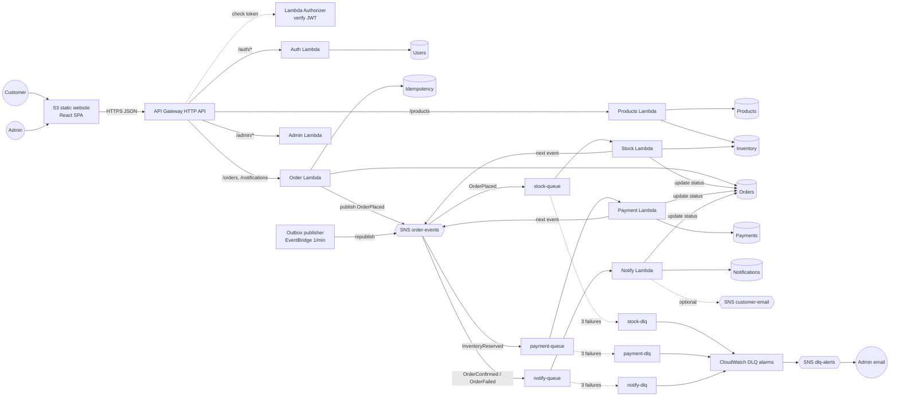
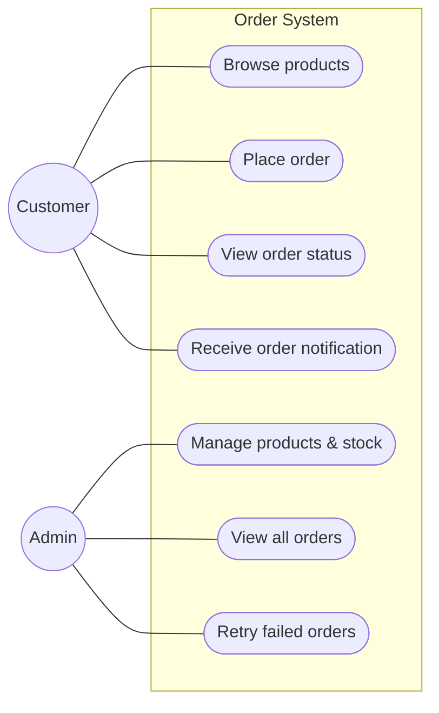

# Architecture

## Component diagram



## Mapping to the reference diagram

| Diagram element | Implementation | Notes |
|---|---|---|
| Frontend S3 static website | `aws_s3_bucket_website_configuration` | CloudFront optional (`enable_cloudfront`) |
| API Gateway POST /orders | HTTP API with 22 routes | all routes in `terraform/api_gateway.tf` |
| Lambda Authorizer – verify JWT | `authorizer` function (HTTP API `REQUEST` authorizer, simple responses, 5 min cache per token) | Verifies HS256 signature, issuer, token type and expiry; passes `userId`/`role` to the target Lambda |
| Auth Lambda register/login | `auth` function → Users table | Stores profile + PBKDF2 password hash, issues access (1 h) and refresh (1 day) JWTs |
| Users table | `users` | |
| Order Lambda create order | `orders` function | also order status/history/notifications |
| Orders table save PENDING | `orders` (+ `idempotency`) | transactional outbox marker on the order |
| OrderPlaced SNS topic | `order-events` | carries all lifecycle events; queues filter by `eventType` |
| stock-queue → Stock Lambda → Inventory | `stock` queue/function, `inventory` table | atomic all-or-nothing reservation |
| payment-queue → Payment Lambda → Payments | `payment` queue/function, `payments` table | simulated; commit or release stock |
| notify-queue → Notify Lambda → Customer email SNS | `notify` queue/function, `notifications` table, optional `customer-email` topic | in-app notification centre always works |
| fail x3 → DLQs | `maxReceiveCount = 3`, one DLQ per queue | |
| DLQ alarm CloudWatch → dlq-alerts SNS → Admin email | `monitoring.tf` | plus queue-age, Lambda-error and API-5xx alarms |
| "update status" arrows | conditional/transactional updates of Orders | |
| (added) Products Lambda, Admin Lambda, Outbox publisher | needed for the use cases "browse products", "manage products & stock", "view all orders", "retry failed orders", and for reliable publishing | |

## Use cases



| Use case | UI | API |
|---|---|---|
| Browse products | Shop, product page | `GET /products`, `GET /products/{id}` |
| Place order | Cart → Place order | `POST /orders` |
| View order status | Order page (live pipeline), My orders | `GET /orders/{id}`, `GET /orders` |
| Receive order notification | Notifications (+ optional email) | `GET /notifications` |
| Manage products & stock | Admin › Products & stock | `GET/POST /admin/products`, `PATCH /admin/products/{id}[/stock]` |
| View all orders | Admin › Overview, Orders | `GET /admin/stats`, `GET /admin/orders[/{id}]` |
| Retry failed orders | Admin › Failed orders, order detail, Queues & alarms | `POST /admin/orders/{id}/retry`, `/cancel`, `GET /admin/dlq-status`, `POST /admin/dlq/{queue}/redrive` |

## Code layout

```
backend/src/order_system/
  handlers/      Lambda entry points (API routers, SQS workers, outbox) – HTTP/SQS concerns only
  services/      business logic (order, catalog, workflow, retry, admin, auth, outbox)
  repositories/  DynamoDB gateway + per-table repositories, AWS service adapters
  models/        order state machine, event schema
  schemas/       request validation
  utils/         errors, JSON logging, HTTP helpers, ids/time/pagination/backoff
  config/        settings from environment variables
backend/local/   in-memory DynamoDB/SNS/SQS stand-ins + dev server (not deployed)
```

## Deviations from the reference / specification

| Item | Deviation | Reason |
|---|---|---|
| Least-privilege IAM | `LabRole` by default | Learner Lab cannot create roles; least-privilege roles are implemented and used when `use_lab_role = false` |
| Customer email | Optional (`enable_customer_email`) | SNS email needs per-address confirmation; the in-app notification centre is the default channel |
| Topic name | `order-events` | It carries all lifecycle events, not only OrderPlaced |
| S3 website over HTTP | Default | The diagram shows an S3 website; use `enable_cloudfront = true` for HTTPS |
| Checkout | Part of the Cart page | Order summary + Place order on one page; no separate route needed |
