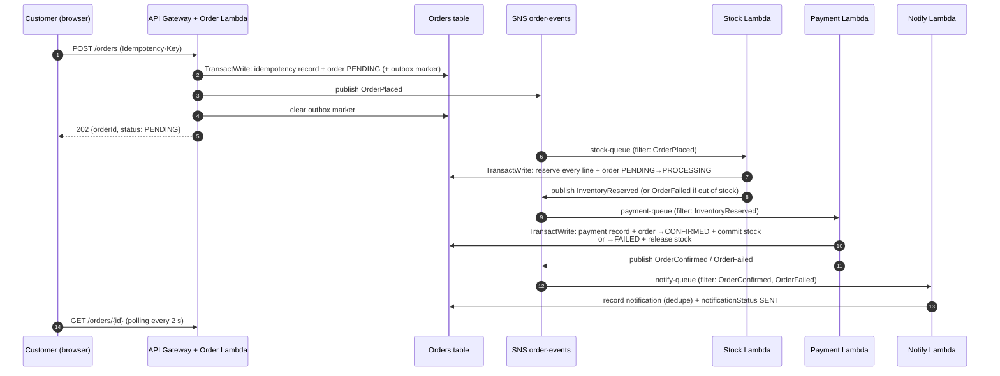
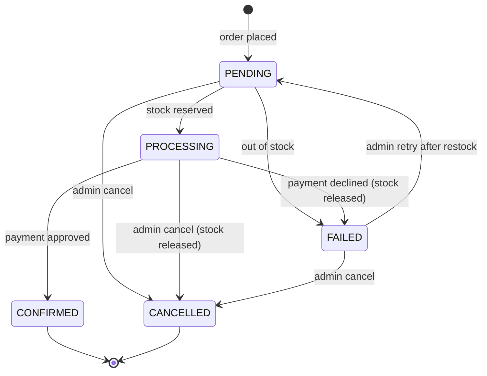

# Order Workflow and State Machine

## 1. Event flow

Why payment does not subscribe to `OrderPlaced` directly: the diagram shows all three queues hanging off one topic.
We keep that (one topic, three subscriptions) but give each subscription an SNS **filter policy** on the
`eventType` message attribute. Payment therefore only receives `InventoryReserved`, which guarantees that
**payment never runs before stock is reserved** and that a failed stock check never results in a charge.

## 2. Status fields

| Field | Values | Owner |
|---|---|---|
| `status` | `PENDING`, `PROCESSING`, `CONFIRMED`, `FAILED`, `CANCELLED` | all steps |
| `inventoryStatus` | `PENDING`, `RESERVED`, `OUT_OF_STOCK`, `COMMITTED`, `RELEASED` | stock / payment / cancel |
| `paymentStatus` | `PENDING`, `SUCCEEDED`, `FAILED`, `SKIPPED` | payment / stock / cancel |
| `notificationStatus` | `PENDING`, `SENT`, `SKIPPED` | notify / cancel |
| `failureCategory` | `BUSINESS`, `PAYMENT_DECLINED`, `TRANSIENT`, `PERMANENT` | failing step |
| `attempt` | 0, 1, 2 … (shown as `retryCount`) | admin retry |
| `version` | incremented on every state change | optimistic locking |

## 3. State transition table

| # | From `status` (and sub-status) | Trigger | To | Side effects (same DynamoDB transaction) |
|---|---|---|---|---|
| 1 | — | `POST /orders` | `PENDING` | idempotency record, outbox marker |
| 2 | `PENDING` / inv `PENDING` | Stock Lambda: every line has stock | `PROCESSING` / inv `RESERVED` | each line: `available -= q`, `reserved += q` (condition `available >= q`) |
| 3 | `PENDING` / inv `PENDING` | Stock Lambda: any line short | `FAILED` / inv `OUT_OF_STOCK`, pay `SKIPPED` | nothing reserved (all-or-nothing) |
| 4 | `PROCESSING` / inv `RESERVED` / pay `PENDING` | Payment approved | `CONFIRMED` / inv `COMMITTED`, pay `SUCCEEDED` | payment record; each line `reserved -= q`, `sold += q` |
| 5 | `PROCESSING` / inv `RESERVED` / pay `PENDING` | Payment declined | `FAILED` / inv `RELEASED`, pay `FAILED` | payment record; each line `available += q`, `reserved -= q` (**compensation**) |
| 6 | `CONFIRMED` or `FAILED` / notif `PENDING` | Notify Lambda | notif `SENT` | notification record (conditional put = dedupe) |
| 7 | `PENDING`, `PROCESSING`, `FAILED` | Admin cancel | `CANCELLED` | if inv was `RESERVED`: release every line |
| 8 | `FAILED` / inv `OUT_OF_STOCK` | Admin retry, stock now sufficient | `PENDING` (attempt+1) | statuses reset, failure fields removed, outbox `OrderPlaced` |
| 9 | `PENDING` stuck ≥ `STUCK_ORDER_SECONDS` | Admin retry | `PENDING` (attempt+1) | outbox `OrderPlaced` |
| 10 | `PROCESSING` / pay `PENDING` stuck | Admin retry | `PROCESSING` (attempt+1) | outbox `InventoryReserved` |
| 11 | `CONFIRMED`/`FAILED` / notif `PENDING` stuck | Admin retry | unchanged (same attempt) | outbox outcome event |

Not allowed (no code path, enforced by conditions): `PENDING → CONFIRMED` (payment cannot be skipped),
anything out of `CONFIRMED` or `CANCELLED`, `FAILED (payment declined) → retry`.

## 4. How races, duplicates and late events are handled

| Problem | Protection |
|---|---|
| Two customers buy the last unit at the same time | Each reservation is a conditional update `available >= q`. DynamoDB serialises them; the loser's transaction is cancelled and its order becomes `OUT_OF_STOCK`. Stock can never go negative. (`test_concurrent_orders_for_last_unit`) |
| Multi-line order where only some lines have stock | All lines + the order update are **one** `TransactWriteItems`; either everything is reserved or nothing is. No partial reservations, so no rollback is needed for this step. |
| SQS delivers the same message twice | The order update inside each transaction is conditioned on the expected source state (e.g. `status = PENDING AND inventoryStatus = PENDING AND attempt = :a`). The duplicate's condition fails, nothing changes. The payment record's key is `(orderId, attempt)` with `attribute_not_exists`, so a second charge record is impossible. Notification ids are deterministic (`ntf_<order>_<attempt>_<type>`), so a second notification is impossible. |
| Lambda crashes after the DB commit but before publishing the next event | The message is redelivered; the handler sees the step already done and **re-publishes** the follow-up event (`_resume_after_stock`, `_resume_after_payment`). Downstream handlers are idempotent. |
| SNS publish fails right after the order is created | The order carries an outbox marker written in the same transaction; the scheduled outbox publisher re-publishes it. (`test_publish_failure_leaves_outbox_marker_and_sweeper_recovers`) |
| A message from before an admin retry arrives late (e.g. a DLQ redrive) | Events carry the order's `attempt`. Handlers ignore events whose attempt is lower than the order's (`STALE`). |
| A late event after the order is final | Every transition requires a specific non-final source state; final states have no outgoing transitions. (`test_late_event_cannot_overwrite_terminal_state`) |
| Two admins retry at the same time / double click | Retry and cancel are conditioned on the `version` that was read plus a cooldown on `lastRetryAt`; the second gets `409 RETRY_CONFLICT`. |
| Payment and cancel race | Both require `status = PROCESSING`; whichever commits first wins, the other fails its condition. |

## 5. Retries: who retries what

| Layer | What | Limit |
|---|---|---|
| Application | SNS publish inside a Lambda: exponential backoff with full jitter | 3 tries, < 0.5 s |
| boto3 | DynamoDB/SNS throttling and 5xx | standard retry mode, 4–5 attempts |
| SQS | Whole message, after the visibility timeout (120 s) | `maxReceiveCount = 3`, then DLQ |
| Admin | Whole order, new `attempt` | `MAX_RETRIES = 5` per order |

Permanent failures (invalid JSON, unknown order, wrong event type, inconsistent data) are **not** retried:
the worker copies the message to its DLQ with an `errorReason` attribute (raising the DLQ alarm) and deletes it.

## 6. Failure classification for admin retry

| Situation | Category | Retryable? | Retry action |
|---|---|---|---|
| Out of stock, still short | `BUSINESS` | No – restock first | — |
| Out of stock, now restocked | `BUSINESS` | Yes | `RESTART` (new attempt from the stock step) |
| Payment declined | `PAYMENT_DECLINED` | No – customer re-orders | — |
| `PENDING` with no progress ≥ 120 s (stock message in DLQ) | `TRANSIENT` | Yes | `REPUBLISH_ORDER_PLACED` |
| `PROCESSING` with payment pending ≥ 120 s (payment message in DLQ) | `TRANSIENT` | Yes | `REPUBLISH_INVENTORY_RESERVED` |
| Outcome decided but notification pending ≥ 120 s | `TRANSIENT` | Yes | `RENOTIFY` |
| Invalid message | `PERMANENT` | No | inspect DLQ, fix data |

## 7. Simulated payment

There is no payment gateway and no card data. `PAYMENT_SIMULATION_MODE`:

* `deterministic` (default): approve, unless an order line has an admin-set test behaviour
  (`PAYMENT_DECLINE` → declined; `PAYMENT_TRANSIENT_ONCE` → timeout on attempt 0 so the message reaches the DLQ,
  and the admin retry (attempt 1) succeeds). Honoured only when `ENABLE_TEST_SCENARIOS=true`.
* `random`: decline with probability `PAYMENT_FAILURE_RATE`.

A real integration would add: a payment intent created with the provider's own idempotency key, webhook
confirmation (asynchronous), refunds as compensation after capture, and PCI-scoped handling of card data
in the provider's hosted fields — none of which exists here. `SUCCEEDED` in this system only means the
simulation approved it.
